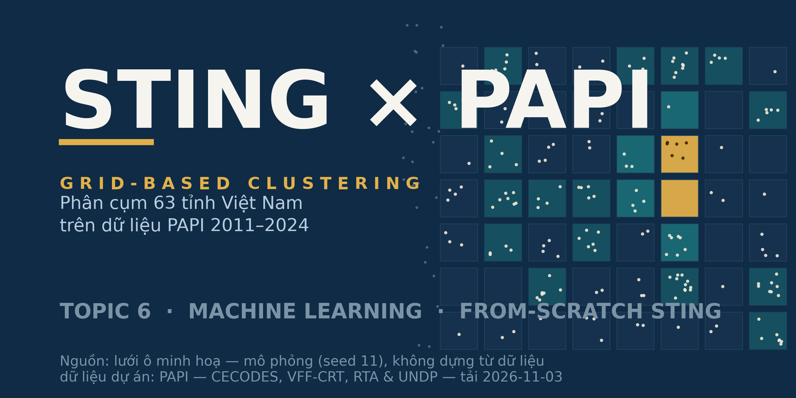

# Đồ án Học máy — Phân cụm 63 tỉnh Việt Nam bằng STING (PAPI 2011–2024)

[](https://github.com/JasonTM17/Grid_Based_Sociology/actions/workflows/ci.yml)
[](LICENSE)

<p align="center"></p>

Đồ án môn Học máy · Chủ đề 6: **Grid-based (clustering)** · Domain: Sociology / History.

**Sắp demo/thi?** Xem [`DEMO.md`](DEMO.md) — một lệnh kiểm tra sẵn sàng: `python scripts/demo_smoke.py` (phải in "SAN SANG DEMO (33/33)").

## Cấu trúc dự án

| Thư mục | Nội dung |
|---|---|
| `plans/` | Kế hoạch triển khai (không commit theo quy định công cụ) |
| `data/raw/papi/` | 14 workbook PAPI 2011–2024 (nguồn: papi.org.vn, dữ liệu công khai; manifest+hash: `PROVENANCE.md`) |
| `data/raw/mendeley/` | Gói replication CC BY 4.0 — 4 file nhỏ dùng trực tiếp được commit (+`PROVENANCE.md`); phần còn lại tải theo DOI |
| `data/raw/boundaries/` | GeoJSON 63 tỉnh (Open Development Vietnam, CC-BY-SA 4.0; lưu ý join: xem `PROVENANCE.md`) |
| `data/processed/` | Panel sạch (kết quả Phase 2) |
| `src/` | Thư viện STING (tự viết từ đầu) |
| `scripts/` | Script dữ liệu & phân tích |
| `models/` | Model STING đã huấn luyện + tham số chuẩn hóa (dùng cho dự đoán) |
| `notebooks/` | Notebook nộp bài (Jupyter) |
| `tests/` | Unit test |
| `results/figs/` | Hình kết quả |
| `reports/` | Báo cáo, ghi chú |
| `slides/` | Slide trình bày |

## Nguồn dữ liệu & giấy phép

- **PAPI 2011–2024** — CECODES / VFF-CRT / RTA / UNDP. Tải từ <https://papi.org.vn/du-lieu-papi/>.
- **Gói replication** — Le et al., Mendeley Data, CC BY 4.0. DOI: 10.17632/wbk42j9wc8.1.
- **GeoJSON tỉnh** — Open Development Vietnam (OD Mekong), CC-BY-SA 4.0.
- Bằng chứng nguồn gốc (URL, ngày tải, giấy phép, SHA-256): các file `PROVENANCE.md` trong `data/raw/*/`.

## Chạy nhanh

```powershell
# Kiểm tra môi trường
python -c "import pandas, openpyxl, plotly, sklearn, streamlit; print('ok')"

# Unit test STING (22 tests, ~99% coverage cho src/sting.py)
python -m pytest tests -q
python -m pytest tests --cov=src -q

# Lint (tùy chọn): python -m pip install -r requirements-dev.txt
python -m ruff check src scripts tests

# Kiểm tra dữ liệu (sau khi panel được tạo ở Phase 2)
python scripts/check_data.py
```

Ghi chú: `jupyter` CLI chưa vào PATH — dùng `python -m jupyter` / `python -m nbconvert`.

## Dự đoán (train quá khứ → dự đoán năm mới)

Toàn bộ chạy **local, không cần dịch vụ ngoài**. Ba bước:

```powershell
python scripts/predict_sweep.py        # 1) chốt cấu hình (train-only, KHÔNG nhìn 2024)
python scripts/predict_demo.py         # 2) STING: học 2011–2023 → dự đoán cụm 2024
python scripts/predict_supervised.py   # 3) model ML có giám sát (scikit-learn)
```

1. **`predict_sweep.py`** — quét cặp sub-dimension trong allowlist đã sàng lọc;
   mean-jump heuristic chỉ dùng giai đoạn train ≤2020 để xét eligibility, sau đó
   chọn cấu hình bằng train/validation 2021–2022. Dimension-level `d1–d6` chưa vào
   sweep vì thang 1–10 không tự chứng minh tính tương đương xuyên năm. Bảng đầy đủ:
   `results/predict_config_search.csv`.
2. **`predict_demo.py`** — STING `fit → save → load → predict`: lưu model local
   (`models/sting_predict_model.pkl`) rồi nạp lại để gán cụm ngoài mẫu năm 2024.
   Chỉ hàng đủ hai feature được dự đoán (hiện 61/63 tỉnh; tỉnh thiếu bị loại,
   không nội suy). `-1` nghĩa là điểm nằm ngoài ô dày đã học, không phải cụm thường.
   Kết quả: `results/predict_all_years.csv`,
   `results/predict_summary.md` (gồm độ nhạy theo `min_count` và chuyển cụm tách riêng
   "chuyển thật" vs "chuyển sang/từ nhiễu"), `results/figs/predict_2024.png`.
3. **`predict_supervised.py`** — model có giám sát, lưu local bằng joblib:
   - **Hồi quy (chính):** dự báo *6.1 Y tế công lập* năm t+1 từ 8 sub-dimension năm t.
     Chọn họ model theo R² CV train-only (GroupKFold theo origin): hiện Ridge được chọn
     với R²=0.451; MAE holdout 2023→2024 là 0.0640 so với carry-forward 0.0683
     (giảm 6.3%). Random Forest có MAE holdout thấp hơn (0.0616) nhưng CV thấp hơn,
     nên không chọn bằng cách nhìn holdout. Đây vẫn chỉ là một năm holdout.
     Lưu `models/sup_ridge.joblib`, `models/sup_rf.joblib`; kết quả
     `results/supervised_metrics.csv` + `results/supervised_summary.md`.
   - **Phân loại phụ:** dự báo pseudo-label STING cutoff-local cho năm sau, với expanding
     CV theo origin 2017–2022 (warm-up 2011–2016). CV chọn Logistic Regression
     (macro-F1 0.434; majority baseline 0.228). Trên holdout 2023→2024, macro-F1 là
     0.541 so với baseline 0.157. Đây là mức khớp với nhãn do STING sinh, không phải
     accuracy so với ground truth xã hội; một holdout không chứng minh tổng quát hóa.

## Dashboard phân tích local

Cài dependency và chạy từ thư mục gốc dự án:

```powershell
python -m pip install -r requirements.txt
python -m streamlit run app.py
```

Dashboard chỉ đọc panel, cấu hình, kết quả và model local đã lưu; không huấn luyện lại,
không sửa artifact và không gửi dữ liệu ra ngoài. Nếu artifact bị thiếu, app báo file và
lệnh pipeline cần chạy để tạo lại. Bộ lọc năm/tỉnh/cụm ở phần STING không áp dụng cho hồi
quy: holdout luôn là 2023→2024; phần hồi quy chỉ lọc theo tỉnh và assignment cụm ở năm gốc
2023. Kết quả 2024 của STING là assignment vào lưới train trước đó, không phải accuracy có
nhãn chuẩn. Metric hồi quy có một năm holdout; classifier đo khớp pseudo-label STING.

Nạp model để dự đoán điểm mới:

```python
import json, sys
sys.path.insert(0, "src")
import numpy as np
from sting import STING

model = STING.load("models/sting_predict_model.pkl")
info = json.load(open("models/sting_predict_scaler.json", encoding="utf-8"))
mean, scale = np.array(info["mean"]), np.array(info["scale"])

x = np.array([[1.9, 1.9]])           # [sd_4_2, sd_6_1] của tỉnh mới
z = (x - mean) / scale
print(model.predict(z))               # -> cụm dự đoán (hoặc -1: nhiễu/ngoài vùng học)

import joblib
ridge = joblib.load("models/sup_ridge.joblib")
print(ridge.predict(np.array([[1.5, 2.6, 2.0, 2.1, 1.9, 1.7, 1.9, 1.8]])))  # dự báo 6.1 năm sau
```

**Lưu ý thang đo:** `scripts/check_data.py` đánh dấu cột có bước nhảy mean năm >0.25;
đây là heuristic cần đối chiếu workbook/codebook, không tự chứng minh đổi thang. Ví dụ
`sd_5_4` có thay đổi khoảng điểm được ghi trong workbook. Sweep chỉ dùng allowlist
sub-dimension không bị flag trong giai đoạn train; dimension-level scores không được
đưa vào cho tới khi chứng minh được tính so sánh xuyên năm. [PAPI 2024 One Pager](https://papi.org.vn/wp-content/uploads/2025/04/26_Thanh_Hoa_ENG.pdf) ghi thang dimension
1–10 và đánh dấu thay đổi sub-dimension/indicator ở một số dimension năm 2021.

## Giấy phép

- **Mã nguồn** (`src/`, `scripts/`, `notebooks/`, `tests/`): **MIT** — xem [`LICENSE`](LICENSE).
- **Dữ liệu** (`data/raw/*/`): giữ giấy phép gốc từng nguồn — xem `PROVENANCE.md` trong từng thư mục (PAPI: dữ liệu công khai CECODES/VFF-CRT/RTA/UNDP; Mendeley: CC BY 4.0, DOI 10.17632/wbk42j9wc8.1; GeoJSON: CC-BY-SA 4.0) — không thuộc MIT.
- **Tác giả:** Nguyễn Tiến Sơn (MSSV 24110054) · Trần Thị Ngọc Quyên (MSSV 24110051) — đồ án môn Học máy, Topic 6.
