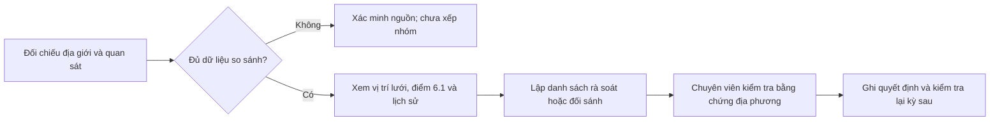

# STING–PAPI: từ phân cụm đến quyết định và phát triển mô hình

**Kết luận:** STING nên được dùng như một lớp sàng lọc hai chiều để chọn ca rà soát và đối sánh, không phải bộ chấm điểm địa phương. Bản thống kê và tệp giao nằm trong [hồ sơ bàn giao 2024](ban-giao-khach-hang-2024.md). Các bước vận hành và phát triển dưới đây là **đề xuất**, không phải hoạt động đã triển khai.

## Phân cụm giúp gì ngoài việc đặt ngưỡng?

So sánh ba quy tắc trên **cùng 61 tỉnh đủ hai chỉ tiêu quan sát năm 2024**. Mốc 6.1 là `Q25 − 0,5 × IQR` của vùng lõi năm 2024 (xấp xỉ 1,8791), dùng để mô tả và lập danh sách rà soát, không phải chuẩn quốc gia hay nhãn đúng/sai.

| Quy tắc sàng lọc | Kết quả trên 61 tỉnh | Quyết định phù hợp |
|---|---|---|
| Chỉ lấy ô thưa `−1` | 13 tỉnh: 8 ca biên 4.2 và 5 ca ưu tiên y tế | Phát hiện ca nằm ngoài vùng dày, nhưng không phân biệt nên học kinh nghiệm hay rà soát y tế. |
| Chỉ lấy 6.1 dưới mốc | 12 tỉnh: 5 ngoài vùng dày và 7 trong vùng lõi | Không bỏ qua tỉnh 6.1 thấp chỉ vì vẫn nằm trong vùng dày. Dùng cho danh sách theo dõi rộng. |
| Kết hợp cả hai tín hiệu | 5 tỉnh vừa ở ô thưa vừa dưới mốc 6.1 | Danh sách rà soát trước khi nguồn lực có hạn; vẫn giữ 7 tỉnh vùng lõi trong luồng theo dõi riêng. |

Đây là **khác biệt về cách sử dụng**, không phải bằng chứng STING dự báo tốt hơn một ngưỡng đơn giản. Trên cùng dữ liệu đã dùng để xây mốc, chưa có nhãn độc lập về nhu cầu rà soát. Cần kiểm tra thêm xem thông tin lưới và lịch sử thực sự giúp chuyên viên tìm đúng ca hay chỉ làm danh sách phức tạp hơn.

**Hai ca minh họa:** Gia Lai rời Cụm 2 năm 2024, điểm 6.1 giảm khoảng 0,085 so với 2023: xem lại cả thay đổi điểm và cấu phần gốc. TP. Hồ Chí Minh vẫn ở Cụm 2 dù điểm 6.1 năm 2024 là 1,759, dưới mốc 1,8791: giữ theo dõi, không kết luận vị trí trong cụm đồng nghĩa với điểm y tế tốt. Tra ngược theo mã tỉnh trong [bảng nguồn](../results/stakeholder_province_summary_2024.csv) và [bảng dịch chuyển](../results/stakeholder_summary.md).

## Quy trình đề xuất cho khách hàng

| Đầu mối | Việc làm | Đầu ra để kiểm tra |
|---|---|---|
| Dữ liệu | Đối chiếu năm, mã tỉnh, địa giới, phạm vi mẫu và phiên bản thang đo. Ghi riêng dữ liệu thiếu; nếu địa giới đổi và không có đối chiếu đáng tin, không nối chuỗi. | Bảng nguồn, phiên bản dữ liệu và danh sách dòng không so sánh được. |
| Chuyên viên phân tích | Mở từng phiếu ưu tiên; kiểm tra cấu phần 6.1 và chuyển dịch 4.2/6.1. Chọn ca đối sánh bằng mức tương đồng về bối cảnh và phạm vi khảo sát, không chỉ vì cùng cụm. | Phiếu có bằng chứng ủng hộ, bằng chứng trái chiều và việc cần xác minh. |
| Đơn vị chuyên môn địa phương | Kiểm tra dấu hiệu bằng dữ liệu có sẵn như phản hồi người dân, thời gian chờ hoặc nguồn vận hành có định nghĩa phù hợp; không coi các ví dụ này là biến đã có trong mô hình. | Kết quả: xác nhận cần rà soát, chưa đủ bằng chứng hoặc không xác nhận; kèm lý do và thời điểm. |
| Chủ quyết định | Chốt đầu việc, đầu mối và kỳ xem lại. Không tự động phân bổ ngân sách hay can thiệp từ nhãn lưới. | Nhật ký quyết định, danh sách hành động và trạng thái ở kỳ tiếp theo. |

Đo hiệu quả của quy trình bằng số ca có căn cứ để hành động trong cùng thời lượng rà soát, mức bỏ sót qua kiểm tra bổ sung ở các tỉnh không được chọn và mức đồng thuận giữa người rà. Các kết quả đó hiện **chưa được đo**.

## Phát triển tiếp theo, theo thứ tự ưu tiên

| Ưu tiên | Câu hỏi cần trả lời | Thiết kế đề xuất | Điều kiện để tiến tiếp |
|---|---|---|---|
| 1. Kiểm chứng giá trị sử dụng | STING có giúp nhóm chuyên viên chọn ca tốt hơn cách chỉ xem 6.1? | So sánh danh sách theo điểm 6.1, STING và quy tắc kết hợp trên cùng số ca được rà. Đầu mối độc lập ghi kết luận mà không thấy cách chọn; rà cả một phần ca không được chọn để kiểm tra bỏ sót. | Chỉ giữ thêm lớp STING nếu cải thiện quyết định so với cách đơn giản và chênh lệch không đến từ nhóm có hồ sơ đầy đủ hơn. Nếu chưa có nhãn xác nhận, chỉ kết luận về độ ổn định danh sách. |
| 2. Kiểm tra độ bền theo thời gian | Danh sách có đổi mạnh vì cách chia lưới hoặc đổi thang đo không? | Hồi kiểm cuốn chiếu theo năm; mỗi mốc chỉ fit chuẩn hóa, lưới và chọn tham số bằng dữ liệu trước năm đích. Giữ phiên bản lưới cố định làm đối chứng; khi thử thuật toán khác, giữ cùng mẫu và tiền xử lý. Xem độ phủ, tỉ lệ ô thưa, độ ổn định danh sách và silhouette trên cùng tập điểm; dùng ARI để đo đồng thuận, không coi phân hoạch cũ là sự thật. | Phân biệt được biến động do điểm quan sát với biến động do lựa chọn mô hình, đổi thang hoặc địa giới. Không thay cấu hình chỉ vì một chỉ số hình học tăng. |
| 3. Thử dự báo có câu hỏi nghiệp vụ riêng | Có dự báo đáng tin hơn cách giữ nguyên điểm năm trước không? | Tách dự báo điểm khỏi dự báo sự kiện cần rà soát. Trước hết so sánh Ridge với giữ nguyên trên nhiều mốc có cùng tập tỉnh; đọc MAE/RMSE theo từng chỉ tiêu. Nếu có nhãn độc lập, đánh giá danh sách cảnh báo trên cùng sức chứa rà soát bằng precision/recall và kiểm tra hiệu chỉnh trước khi gọi là xác suất. Tách năm đánh giá cuối khỏi chọn mô hình. | Chỉ gọi là cảnh báo vận hành nếu có kết quả ngoài mẫu, lợi ích so với mốc đơn giản và kiểm chứng trên nhiều năm. Không dùng AUC thăm dò năm 2024 làm điều kiện duy nhất. |
| 4. Giải thích thay đổi và thử can thiệp | Cải thiện thật đến từ đâu? | Bổ sung nguồn có định nghĩa và phạm vi rõ; kiểm tra lại cấu phần khảo sát, chất lượng mẫu và khác biệt nền. Nếu khách hàng muốn đo tác động một sáng kiến cụ thể, lập thiết kế đánh giá riêng với nhóm so sánh và giả định có thể kiểm tra. | Chỉ kết luận tác động nếu thiết kế và dữ liệu độc lập thực sự hỗ trợ; không suy nguyên nhân từ cụm hoặc tương quan GRDP. |

Nếu thời lượng đồ án chỉ đủ cho một bước nữa, làm **đối chứng ngưỡng 6.1 với STING trên cùng số ca rà**, thay vì tăng số mô hình. Nếu chưa có chuyên viên hoặc nhãn độc lập, làm **kiểm tra độ bền theo năm** trước và nêu rõ chưa đo hiệu quả ra quyết định.

**Nguồn kỹ thuật để tiếp tục:** [hồ sơ và bootstrap cụm](../results/cluster_profile.md), [kiểm tra độ nhạy giao thức](../results/protocol_sensitivity.md), [ứng viên mô hình thăm dò](../results/model_improvement_candidates.md), [mã dự báo và chấm điểm theo năm](../scripts/common/papi_forecast.py). Các ứng viên trong tài liệu kỹ thuật không thay thế cấu hình đang bàn giao.

## Kết quả thí nghiệm lựa chọn cùng số ca

Thí nghiệm bổ sung dùng **cùng tập tỉnh đủ hai điểm trong từng năm**, chỉ xét các điểm **đã quan sát** của năm đó để chọn danh sách rà soát. Lưới và scaler chỉ fit trên các năm trước. Cặp chỉ tiêu và tham số được giữ theo cấu hình công bố; do quá trình chọn cấu hình từng dùng 2021–2022, bảng 2018–2022 là **hồi cứu**, còn 2023–2024 là các mốc sau cửa sổ chọn cấu hình, **không phải dữ liệu tương lai đăng ký trước**. Không thay đổi mô hình hay bảng bàn giao chính.

- **Chỉ y tế:** xếp 6.1 thấp trước. **Chỉ STING:** ưu tiên ngoài biên lưới, sau đó ô thưa, rồi vùng dày; trong mỗi vùng ưu tiên ô ít điểm huấn luyện hơn. **Kết hợp:** ưu tiên trạng thái lưới theo cùng thứ tự, sau đó ưu tiên 6.1 thấp. Đồng hạng dùng mã tỉnh; hai cách có STING là **quy tắc xếp ưu tiên thử nghiệm**, không phải ba phương án tự động ra quyết định và không thay thế quy tắc ngưỡng trong bảng bàn giao.
- Với ngân sách **5 ca**, 2023 chọn trùng **5/5** giữa cách chỉ y tế và cách kết hợp; 2024 trùng **3/5**, tức thay **2 ca**. Cách chỉ STING trùng **2/5** với chỉ y tế năm 2023 và **0/5** năm 2024. Với ngân sách **10 ca**, cách kết hợp trùng **7/10** năm 2023 và **5/10** năm 2024 với chỉ y tế.
- Giữ nguyên 61 quan sát 2024 và chỉ cập nhật lịch sử dựng lưới từ hết 2022 lên hết 2023: **5 tỉnh đổi trạng thái lưới**, danh sách kết hợp giữ **3/5** ca cũ. Trên **59 tỉnh** có đủ điểm ở cả 2023 và 2024, cả danh sách chỉ y tế và kết hợp đều giữ **2/5** ca giữa hai năm khi xếp lại trên cùng tập. So sánh này đo mức thay đổi danh sách, không đo ca nào đúng.
- **Quyết định đề xuất:** báo song song danh sách đơn giản và danh sách kết hợp, ghi rõ ca được đổi khi cập nhật lưới. Không ưu tiên phương pháp chỉ vì nó tạo danh sách khác, cũng không tự động loại ca có điểm y tế thấp nhưng thuộc vùng dày.

**Tái lập:** chạy `python -X utf8 -m scripts.analysis.review_shortlist_backtest` từ gốc repo. [JSON tổng hợp](../results/review_shortlist_backtest.json) ghi mẫu số, mốc fit, giao/hợp danh sách và hash của nguồn. [CSV thứ hạng](../results/review_shortlist_ranks.csv) dùng để kiểm tra từng dòng, **không gửi cho chuyên viên trước khi khóa phiếu**.

**Bước nghiệm thu độc lập:** [quy trình thẩm định và tạo phiếu](quy-trinh-tham-dinh-danh-sach-papi.md). Phiếu cho chuyên viên tách khỏi khóa chọn mẫu; không dùng nhãn STING hoặc điểm PAPI làm bằng chứng tự xác nhận. Khi chưa có phiếu đã điền, chưa thể kết luận STING cải thiện quyết định so với chỉ xem 6.1.
